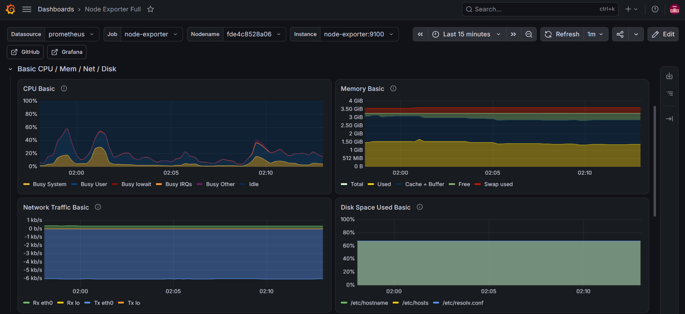
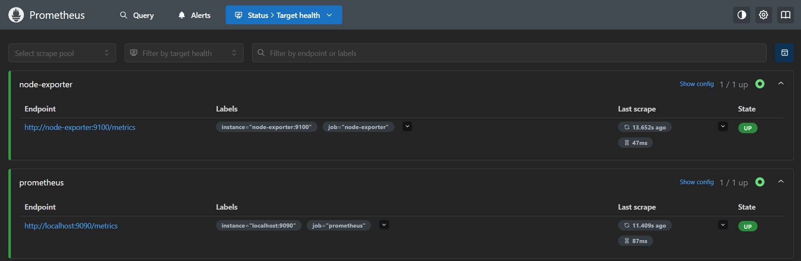
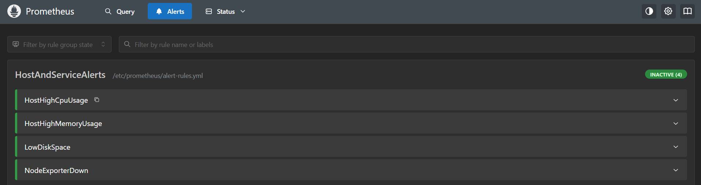
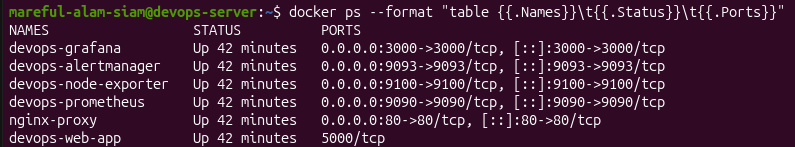

# Linux Server Monitoring & Deployment Lab

A practical Linux administration and DevOps lab running on an Ubuntu 24.04 VM. This project covers containerizing a web service, setting up a reverse proxy, configuring real-time Prometheus monitoring with alerts, and automating routine sysadmin tasks using Bash scripts and Ansible.

---

## Architecture

```text
[ Client Request ]
        │
        ▼ Port 80
 ┌──────────────┐
 │ Nginx Proxy  │
 └──────┬───────┘
        │
        ▼ Port 5000 (Internal)
 ┌──────────────┐
 │  Flask App   │
 └──────────────┘

System Monitoring & Management:
• Node Exporter (:9100) -> Prometheus (:9090) -> Grafana (:3000)
• Prometheus -> Alertmanager (:9093)
• Ansible -> Host config and health check automation
• Cron -> Daily automated tarball backups
```
**Web Traffic:** Nginx handles incoming HTTP on port 80 and reverse-proxies requests internally to the Flask app on port 5000.   
**Observability:** Node Exporter gathers host metrics, Prometheus stores the time-series data, and Grafana visualizes CPU/RAM/Disk stats. Alertmanager handles threshold alerts.   
**Automation:** Bash scripts handle health checks and daily backups via cron, while an Ansible playbook automates server auditing. 

---

## Project Structure

```text
├── ansible/
│   ├── inventory.ini           # Target hosts
│   └── site.yml                # Server audit playbook
├── app/
│   ├── Dockerfile              # Flask container build file
│   ├── app.py                  # Web application source
│   └── requirements.txt        # Python packages
├── monitoring/
│   ├── compose.yml             # Prometheus & Grafana stack
│   ├── prometheus/
│   │   ├── alert-rules.yml     # CPU and host alerts
│   │   └── prometheus.yml      # Metric scrape targets
│   └── alertmanager/
│       └── alertmanager.yml    # Alert notification setup
├── nginx/
│   └── nginx.conf              # Reverse proxy configuration
├── scripts/
│   ├── health-check.sh         # Quick host stats script
│   └── backup.sh               # Tarball backup script
├── compose.yml                 # App and Nginx compose file
└── README.md
```

## Setup & Running

### Requirements
* Ubuntu 22.04 or 24.04 LTS
* Docker & Docker Compose plugin
* Git & Ansible

### 1. Clone Repo & Start the App
```bash
git clone https://github.com/siam-a11y/linux-server-monitoring-platform.git
cd linux-server-monitoring-platform
docker compose up -d
cd monitoring
docker compose up -d
docker ps
```
* **Web App:** `http://<VM_IP>`
* **Grafana:** `http://<VM_IP>:3000` (Default: `admin` / `admin`)
* **Prometheus Targets:** `http://<VM_IP>:9090/targets`
* **Alertmanager:** `http://<VM_IP>:9093`
---

## Maintenance & Tasks
* **Run Health Check:**
  ```bash
  bash scripts/health-check.sh
  ```
* **Run Ansible Audit:**
  ```bash
  ansible-playbook -i ansible/inventory.ini ansible/site.yml
  ```
  * **Automated Daily Backup:**
Added to crontab to run daily at midnight:
```cron
0 0 * * * /bin/bash /home/mareful-alam-siam/devops-lab/scripts/backup.sh >> /home/mareful-alam-siam/backups/backup.log 2>&1
```
---
## Notes & Troubleshooting
1. **Docker Socket Permission Denied:**
   * Encountered permission denied while trying to connect to the docker API at unix:///var/run/docker.sock when running compose without root privileges.
   * Fixed by adding the active user to the docker group: `sudo usermod -aG docker $USER` and re-logging in.
2. **Git Authentication Cleanup:**
   * Cleared embedded Personal Access Tokens from remote URLs to prevent credentials from being saved in the repository history:
```bash
git remote set-url origin https://github.com/siam-a11y/linux-server-monitoring-platform.git
```

## System Verification & Dashboard Previews

### Grafana Host Metrics
Real-time node telemetry highlighting CPU, RAM, Network I/O, and Disk consumption:


### Prometheus Scrape Targets
Verification of active scraping endpoints and target states:


### Active Alert Rules
Loaded alert conditions for threshold monitoring and service failures:


### Container Architecture & Port Mappings
Running Docker containers along with published service ports:

